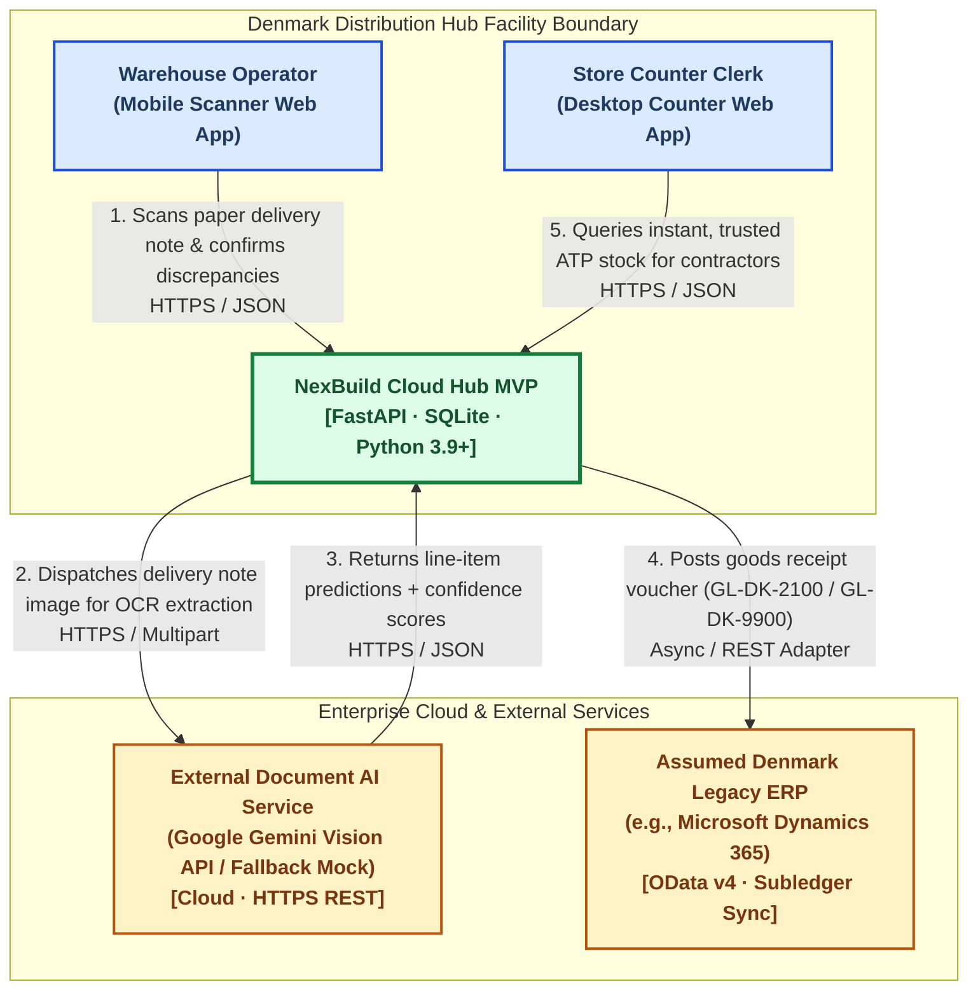
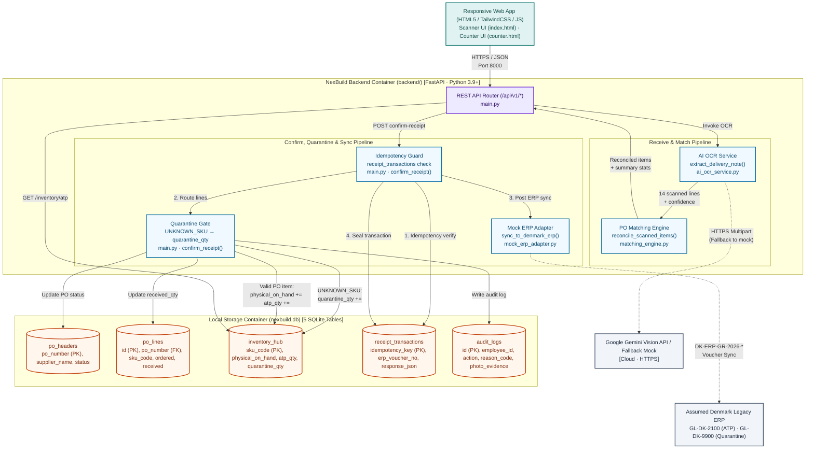

# NexBuild Cloud Hub — System Context & Architecture
**Denmark Phase 1 MVP · Goods Receiving & Real-Time ATP Lookup**

| Field | Value |
|:--|:--|
| **Document Version** | 2.1.0 (Phase 4.5 Refined & PDF Aligned) |
| **Status** | 100% Aligned with Round 1 Proposal & Verified Phase 1–3 Code |
| **Author** | Gia (Team Leader & Backend Architect) · Team TBL Gang |
| **Last Updated** | 2026-11-03 |
| **Build Commit** | `c7bd8fb` — `main` branch |

---

# PAGE 1 — System Context & Core Value Proposition

## 1.1 Executive Summary

The **NexBuild Cloud Hub** is an edge-optimised logistics orchestration system designed for Company A's Denmark Distribution Hub. In Round 1, our team diagnosed the operational root cause of **"Phantom Stock"**: store counter clerks turn away high-value B2B contractors because terminal stock is outdated, while physical pallets sit uncatalogued on inbound receiving docks. The primary driver is the **12–24h batch-processing lag** inherent in the fragmented legacy ERP.

NexBuild Cloud Hub decouples counter stock inquiries from ERP batch cycles via an automated five-stage pipeline:

$$\text{Scan (OCR)} \longrightarrow \text{Match PO} \longrightarrow \text{Confirm (Discrepancy Mgmt)} \longrightarrow \text{Post Hub} \longrightarrow \text{ATP Lookup}$$

The system delivers **sub-second ATP freshness** (`< 15 min` SLA, `< 2s` actual) at the store counter the instant warehouse staff taps "Confirm Receipt", eliminating inventory record inaccuracy at its upstream source.

---

## 1.2 C4 Level 1 — System Context Diagram

---

## 1.3 How This Solves Upstream Phantom Stock & Operational Friction

| Legacy Pain Point (Round 1 Diagnosis) | NexBuild Cloud Hub Solution (Verified in MVP Code) |
|:--|:--|
| **12–24h ERP batch lag** — counter staff sell against stale stock | Local `inventory_hub` updates immediately upon confirmation; ATP is live instantly before ERP batch cycles begin. |
| **Manual paper keying** — ~40% inventory inaccuracy from human typo errors | AI OCR (`ai_ocr_service.py`) automates line ingestion; reconciles 14 lines against PO-48213 in milliseconds. |
| **No discrepancy workflow** — shortfalls or unknown items corrupt ATP | `matching_engine.py` classifies items (`OK`, `SHORT`, `OVER`, `UNKNOWN_SKU`); quarantines uncatalogued SKUs. |
| **Double-counting under yard Wi-Fi drops** — retry storms duplicate inventory | Every submission enforces a client `idempotency_key`; server checks `receipt_transactions` to halt duplicate writes. |
| **Zero audit trail** — no accountability for damaged or short items | `audit_logs` captures `employee_id`, `action`, `reason_code`, and `photo_evidence` on every modified line. |

> **Architectural Assumption (No Rip-and-Replace):** Company A retains legacy country ERPs. For Phase 1 Denmark, we interface with the Assumed Denmark Legacy ERP (e.g., Microsoft Dynamics 365 / WMS Instance) via `mock_erp_adapter.py`, updating General Ledger accounts without touching legacy core code.

---

# PAGE 2 — Container Architecture & Key Design Decisions

## 2.1 C4 Level 2 — Container Diagram

---

## 2.2 Key Architectural Decisions (Verified in Code)

### Decision 1 — Edge Offline Resilience & Idempotency
- **Operational Reality:** Steel-reinforced warehouses experience frequent Wi-Fi drops. Mobile retry storms can cause duplicate goods receipt submissions.
- **Mechanism:** The frontend generates a UUIDv4 `idempotency_key` upon confirmation. `backend/main.py` performs an atomic lookup against SQLite `receipt_transactions`:
  - **First Submission:** Executes receipt, updates inventory & audit logs, dispatches ERP sync, and saves response payload.
  - **Duplicate Retry:** Detects existing key, immediately returns cached JSON with `"is_idempotent_replay": true`, bypassing stock increments entirely.

### Decision 2 — Data Governance: Quarantine Isolation vs. Sellable ATP
- **Operational Reality:** In PO-48213, supplier delivered 12 boxes of `FIX-M8` (Fixings M8) not on the PO (confidence 0.68). Indiscriminately adding uncatalogued goods to sellable ATP causes phantom stock in reverse and violates purchasing controls.
- **Three-Column Isolation in `inventory_hub`:**

| Stock Column | Baseline Before Scan | After PO-48213 Confirm | Verified Operational Effect |
|:--|:--:|:--:|:--|
| `physical_on_hand` | 10.0 | 10.0 | **Unchanged** — unverified stock excluded from sellable count |
| `atp_qty` | 10.0 | 10.0 | **Unchanged** — protected against accidental counter sales |
| `quarantine_qty` | 0.0 | **12.0** (+12) | **Quarantined** — held under `GL-DK-9900-QUARANTINE-HOLD` |

*(Verified PO lines update sellable ATP: `CEM-25`: 120 $\rightarrow$ 200 [+80], `TIM-4595`: 85 $\rightarrow$ 125 [+40], `PLAST-01`: 30 $\rightarrow$ 82 [+52 sheets]).*

### Decision 3 — Two-Step Mathematical Formulation for ATP
To mathematically prevent double-counting inbound deliveries, stock updates follow a strict two-step derivation:

**Step 1 — Goods Receipt Posting (Phase 1 Denmark MVP):**
$$\text{Physical On-Hand}_{\text{new}} = \text{Physical On-Hand}_{\text{current}} + \text{Confirmed Received Qty (excluding quarantined items)}$$

**Step 2 — Available-to-Promise (ATP) Derivation:**
$$\text{ATP} = \text{Physical On-Hand} - \text{Reserved (Soft-Locked) Qty} - \text{Committed Outbound Qty}$$

- **Nordic Roadmap Alignment:** In Phase 1 Denmark, $\text{Reserved} = 0$ and $\text{Committed} = 0 \implies \text{ATP} = \text{Physical On-Hand}$. In Phase 2 (Norway), Soft-Locks are introduced (4h B2C / 24h B2B + 15–20m counter hold); in Phase 3 (Sweden), Committed Outbound orders allocate multi-depot stock.

---

## 2.3 Interface Contract & Runtime Verification (Summary)

- **Route Prefix & Typing:** All endpoints enforce `/api/v1/`, `snake_case` JSON payloads, and Pydantic v2 schemas (`POHeaderResponse`, `ScanDeliveryNoteResponse`, `ReceiptTransactionResponse`, `InventoryATPResponse`).
- **Trust Status SLA:** `GET /api/v1/inventory/atp` dynamically assigns `trust_status`:
  - 🟢 **GREEN**: Updated within 15 minutes (`< 15 min` SLA achieved)
  - 🟡 **AMBER**: Updated within 2 hours
  - 🔴 **RED**: Stale beyond 2 hours
- **Regression Evidence:** 8/8 smoke tests passing (`tests/test_backend_smoke.py`), confirming sub-100ms reset latency (`POST /api/v1/reset-demo`) for zero-friction demo video takes.

---

*Authored by Gia (Team Leader & Backend Architect) · Team TBL Gang · Netcompany IT Consultant Challenge 2026*
