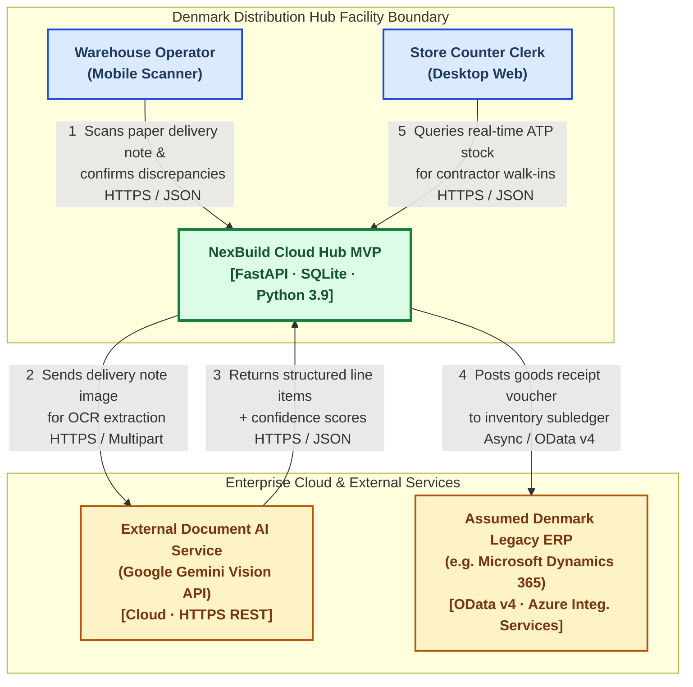
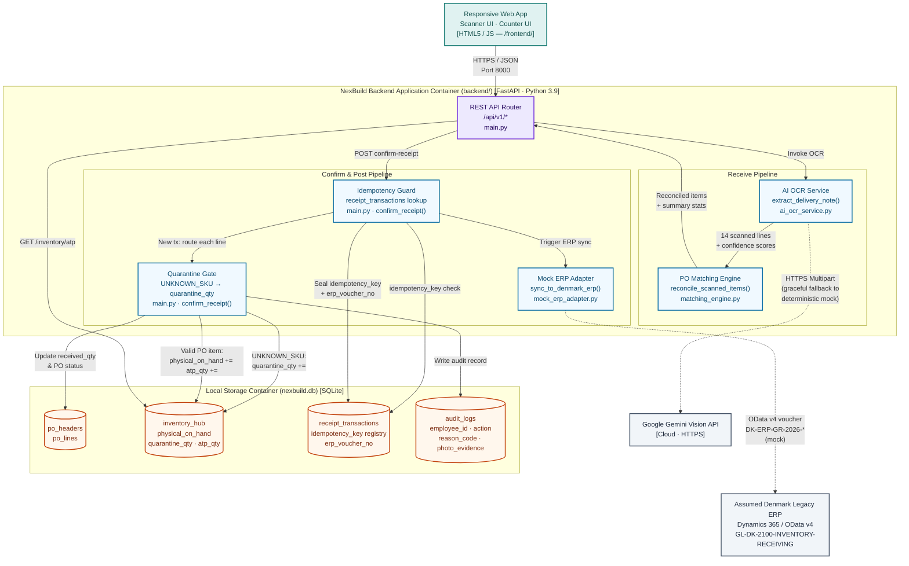

# NexBuild Cloud Hub — System Context & Architecture
**Denmark Phase 1 MVP · Goods Receiving & Real-Time ATP Lookup**

| Field | Value |
|:--|:--|
| **Document Version** | 2.0.0 (Phase 4 Locked) |
| **Status** | Aligned with Round 1 Winning Proposal & Verified Phase 1–3 Code |
| **Author** | Gia (Team Leader & Backend Architect) |
| **Last Updated** | 2026-11-03 |
| **Build Commit** | `c7bd8fb` — `main` branch |

---

# PAGE 1 — System Context & Core Value Proposition

## 1.1 Executive Summary

The **NexBuild Cloud Hub** is an edge-optimised logistics orchestration system designed for Company A's Denmark Distribution Hub. The Round 1 case study identified a critical operational failure: **Phantom Stock** — store counter clerks turn away high-value contractors because their ERP terminals show stale inventory figures, while received pallets sit physically on the receiving dock, uncatalogued for hours. The root cause is the 4–12 hour batch-processing lag in the fragmented, country-specific legacy ERP instance.

NexBuild Cloud Hub eliminates this lag through an automated five-stage pipeline:

```
Scan (OCR)  →  Match PO  →  Confirm (Discrepancy Mgmt)  →  Post Hub  →  ATP Lookup
```

The system provides **sub-second ATP freshness** at the store counter the moment a warehouse operator taps "Confirm Receipt" on the mobile scanner — without waiting for the ERP batch cycle.

---

## 1.2 C4 Level 1 — System Context Diagram

> The following diagram shows every actor, the system boundary, and all external platform interactions for the Denmark Phase 1 MVP.



---

## 1.3 How This Solves the "Phantom Stock" Problem

| Legacy Pain Point | NexBuild Cloud Hub Solution |
|:--|:--|
| **4–12 h ERP batch lag** — store counters see yesterday's stock | Local `inventory_hub` table updated **instantly** on receipt confirmation; ATP is live before the ERP batch even begins |
| **Manual paper data entry** — human transcription errors inflate discrepancies | AI OCR (`ai_ocr_service.py`) digitises delivery notes and auto-reconciles 14 PO lines in milliseconds |
| **No discrepancy workflow** — shortfalls or unknown items silently enter sellable stock | `matching_engine.py` assigns `OK / SHORT / OVER / UNKNOWN_SKU` with confidence scores; unordered items are **quarantined** |
| **Double-counting under poor Wi-Fi** — retry storms in steel-reinforced receiving yards | Every POST carries a client-generated `idempotency_key`; server-side guard in `receipt_transactions` prevents duplicate postings |
| **Zero audit trail** — no photo evidence or reason codes | `audit_logs` captures `employee_id`, `action`, `reason_code`, `photo_evidence` on every line update |

> **Enterprise ERP Assumption:** Company A runs fragmented, country-specific ERP instances across the Nordics with no unified API standard. For Phase 1 we model the system of record as the **Assumed Denmark Legacy ERP (e.g., Microsoft Dynamics 365 / SAP Business One Country ERP Instance)**, interfaced via `mock_erp_adapter.py` which simulates REST/OData voucher ingestion.

---
---

# PAGE 2 — Container Architecture & Key Design Decisions

## 2.1 C4 Level 2 — Container Diagram

> This diagram shows the internal layout of the NexBuild Cloud Hub MVP as implemented in Phase 1–3 source code.



---

## 2.2 Key Architectural Decisions

### Decision 1 — Offline Resilience & Idempotency

**Problem:** Steel-reinforced receiving yard zones cause frequent Wi-Fi drops mid-transaction. Without protection, a mobile retry would POST `confirm-receipt` twice, double-counting 80 bags of `CEM-25` into sellable ATP.

**Solution implemented in `main.py → confirm_receipt()`:**

```
Client                           Server
  │                                │
  │── POST /confirm-receipt ───────►│
  │   {idempotency_key: "uuid-A"}  │  1. CHECK receipt_transactions
  │                                │     WHERE idempotency_key = "uuid-A"
  │                                │  2. NOT FOUND → execute full pipeline
  │                                │     → write inventory, audit, ERP sync
  │                                │     → INSERT receipt_transactions (key="uuid-A",
  │                                │       erp_voucher_no, response_json)
  │◄── 200 {is_idempotent_replay: false} ─│
  │                                │
  │   [Wi-Fi drops, client retries]│
  │                                │
  │── POST /confirm-receipt ───────►│
  │   {idempotency_key: "uuid-A"}  │  1. CHECK receipt_transactions
  │                                │     FOUND → return cached response_json
  │◄── 200 {is_idempotent_replay: true} ─│
  │   [inventory untouched]        │
```

> **Result:** Zero duplicate inventory entries. Verified by `test_idempotent_receipt_replay` in the regression suite.

---

### Decision 2 — Data Governance: Quarantine vs. ATP

**Problem:** Supplier `Nordic BuildSupply DK` delivered 12 boxes of `FIX-M8` (Fixings M8) that were **not on PO-48213**. Automatically adding these to sellable ATP would violate purchasing controls and distort financial subledgers.

**Three-column separation in `inventory_hub`:**

```
Column              FIX-M8 (before)   After confirm-receipt
─────────────────   ───────────────   ─────────────────────
physical_on_hand        10.0              10.0   ← UNCHANGED
atp_qty                 10.0              10.0   ← UNCHANGED
quarantine_qty           0.0              12.0   ← incremented only
```

**Logic path in `main.py → confirm_receipt()`:**

| Condition | Path |
|:--|:--|
| `match_status == "UNKNOWN_SKU"` **OR** `reason_code in ("unordered_quarantine", "not_on_po")` **AND** SKU not on PO | → **Quarantine Gate**: `quarantine_qty += received_qty`. `physical_on_hand` and `atp_qty` untouched |
| `reason_code == "accept_unordered_override"` | → Supervisor override; item accepted into `physical_on_hand` and `atp_qty` |
| Valid PO line (`CEM-25`, `TIM-4595`, `PLAST-01`, …) | → Normal receipt: `physical_on_hand += received_qty`, `atp_qty += received_qty` |

**ERP GL routing in `mock_erp_adapter.py`:**
- PO items → `GL-DK-2100-INVENTORY-RECEIVING` (sellable subledger)
- Quarantined items → `GL-DK-9900-QUARANTINE-HOLD` (pending clearance)

> **Verified stock after PO-48213 confirmation:**  
> CEM-25: 120 → **200** (+80) | TIM-4595: 85 → **125** (+40) | PLAST-01: 30 → **82** (+52) | FIX-M8 ATP: **10** (unchanged, quarantine=12)

---

### Decision 3 — Two-Step ATP Math Model (Phase 1 Denmark MVP)

To prevent double-counting, confirmed inbound receipts update `physical_on_hand` first; ATP is then derived, not stored separately as a running tally of inbound forecasts.

**Step 1 — Goods Receipt Posting:**

$$\text{Physical On-Hand}_{\text{new}} = \text{Physical On-Hand}_{\text{current}} + \text{Confirmed Received Qty}$$

> *Only verified PO items are included. Quarantined/unordered items (e.g. FIX-M8) are explicitly excluded from this calculation.*

**Step 2 — Available-to-Promise Calculation:**

$$\text{ATP} = \text{Physical On-Hand} - \text{Reserved (Soft-Locked) Qty} - \text{Committed Outbound Qty}$$

**Phase roadmap for Reserved and Committed quantities:**

| Phase | Market | Reserved | Committed | ATP Formula simplifies to |
|:--|:--|:--|:--|:--|
| **Phase 1** | 🇩🇰 Denmark MVP | `0` | `0` | `ATP = Physical On-Hand` |
| **Phase 2** | 🇳🇴 Norway Rollout | `> 0` (60-min soft-lock for phone orders) | `0` | `ATP = Physical − Reserved` |
| **Phase 3** | 🇸🇪 Sweden Rollout | `> 0` | `> 0` (multi-site depot transfers) | `ATP = Physical − Reserved − Committed` |

> **Why not store ATP directly?** Storing ATP as a derived column avoids the classic double-counting bug where inbound confirmed receipts are added to both `physical_on_hand` AND a separate `confirmed_inbound` ATP field. Our model enforces a single source of truth: **physical_on_hand** is the only quantity that receipt posting writes to.

---

## 2.3 Matching Engine — Confidence Scoring Rules

When `ai_ocr_service.extract_delivery_note()` returns the 14 scanned lines, `matching_engine.reconcile_scanned_items()` applies the following deterministic business rules:

| Status | Condition | Confidence | `requires_review` | Example |
|:--|:--|:--|:--|:--|
| **`OK`** | `received == ordered` | `0.98` | `False` | CEM-25: 80/80 |
| **`SHORT`** | `received < ordered` | `0.96` | `True` | PLAST-01: 52/60 (deficit -8) |
| **`OVER`** | `received > ordered` | `0.95` | `True` | *(none in demo)* |
| **`UNKNOWN_SKU`** | SKU not in `po_lines` | `0.68` | `True` | FIX-M8: 12 boxes (not on PO) |

> FIX-M8's confidence of `0.68` explicitly signals low OCR certainty — it may be a mis-scanned barcode for a legitimate PO item, reinforcing the need for quarantine review rather than automatic acceptance.

---

## 2.4 REST API Interface Contract

All endpoints use the `/api/v1/` prefix, `snake_case` JSON keys, and Pydantic v2 schema validation.

| Method | Endpoint | Produces | Primary Consumer |
|:--|:--|:--|:--|
| `GET` | `/api/v1/health` | `{status: "ok", active_ocr_mode}` | Monitoring / Load Balancer |
| `GET` | `/api/v1/po/{po_number}` | `POHeaderResponse` (14 lines) | Scanner UI — pre-populate expected quantities |
| `POST` | `/api/v1/scan-delivery-note` | `ScanDeliveryNoteResponse` | Mobile camera capture / barcode scanner |
| `POST` | `/api/v1/confirm-receipt` | `ReceiptTransactionResponse` | Warehouse operator confirmation screen |
| `GET` | `/api/v1/inventory/atp` | `InventoryATPResponse` (trust_status: GREEN/AMBER/RED) | Store Counter ATP portal |
| `GET` | `/api/v1/audit-logs` | Audit log array | Compliance officer / QA lead |
| `POST` | `/api/v1/reset-demo` | `ResetDemoResponse` | Demo administration / QA test harness |

**Trust Status thresholds** (computed at query time from `inventory_hub.last_updated`):
- **GREEN** — updated within 15 minutes
- **AMBER** — updated within 2 hours
- **RED** — stale beyond 2 hours

---

## 2.5 Auditability & Compliance

Every inventory state change writes an immutable record to `audit_logs`:

| Column | Description | Example |
|:--|:--|:--|
| `employee_id` | Warehouse operator badge ID | `EMP-9021` |
| `store_id` | Distribution hub identifier | `DK-Aarhus-01` |
| `po_number` | PO being received | `PO-48213` |
| `sku_code` | Canonical SKU | `FIX-M8` |
| `action` | Classified event type | `QUARANTINED_UNORDERED_SKU` |
| `reason_code` | Standardised variance code | `unordered_quarantine` |
| `quantity_change` | Units affected | `12.0` |
| `photo_evidence` | URI/Base64 to photographic documentation | *(optional)* |
| `details` | Free-text machine-readable detail | `QUARANTINED_UNORDERED_SKU: sku=FIX-M8 qty=12.0` |
| `timestamp` | UTC ISO-8601 | `2026-11-03T15:12:04.000Z` |

---

*Authored by Gia (Team Leader & Backend Architect) · NexBuild Cloud Hub · Round 2 Build-a-thon · Netcompany IT Consultant Challenge 2026*
