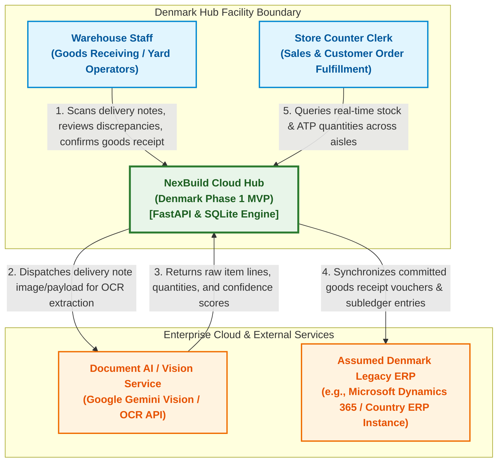

# NexBuild Cloud Hub: System Context & Architecture Specification
**Denmark Phase 1 MVP — Goods Receiving & Real-Time ATP Lookup**  
*Document Version:* 1.1.0 | *Status:* Aligned with Round 1 Winning Proposal | *Author:* Gia (Backend Architect & Team Leader)

---

## 1. Executive Summary & Solution Context

The **NexBuild Cloud Hub** is an edge-optimized logistics orchestration system designed for the Denmark Distribution Hub. In wholesale building supply distribution, physical receiving delays, paperwork discrepancies, and fragmented, country-specific legacy ERP systems create acute inventory latency. Store counter clerks frequently turn away high-value contractors due to stale stock records, even while pallets sit uncatalogued in the receiving yard.

NexBuild Cloud Hub solves this through a five-stage automated pipeline:
$$\text{Scan (OCR)} \longrightarrow \text{Match PO} \longrightarrow \text{Confirm (Discrepancy Mgmt)} \longrightarrow \text{Post Hub} \longrightarrow \text{ATP Lookup}$$

### Key Strategic Objectives
1. **Zero-Latency Available-To-Promise (ATP):** Immediate inventory availability for store counters upon warehouse receipt confirmation, eliminating the typical 4-to-12 hour ERP batch-processing lag.
2. **AI-Assisted Discrepancy Reconciliation:** Automated optical recognition of unstructured delivery notes with real-time PO reconciliation, flagging shortages, overages, and unknown SKUs with confidence scoring.
3. **Quarantine Governance for Unordered SKUs:** Strict isolation of uncatalogued or unordered goods (such as `FIX-M8`) into quarantine inventory, preventing unauthorized addition to sellable ATP without purchasing clearance.
4. **Edge Resilience & Idempotency:** Offline-capable mobile client operations guaranteed by cryptographic idempotency tokens, preventing duplicate postings during intermittent yard Wi-Fi drops.
5. **Auditability & Traceability:** Immutable logging of employee actions, discrepancy reason codes, and visual photo evidence.

> **Architectural Assumption (Enterprise ERP):**  
> As highlighted in our Round 1 case analysis, Company A possesses fragmented, country-specific ERP instances across the Nordics without a unified API standard. For Denmark Phase 1 MVP, we model the system of record as the **Assumed Denmark Legacy ERP (e.g., Microsoft Dynamics 365 / SAP Business One Country ERP Instance)**, interfaced via standard asynchronous REST/OData voucher ingestion.

---

## 2. C4 Level 1: System Context Diagram

The System Context diagram models the actors, system boundaries, and external platform interactions governing the Denmark Distribution Hub.



### Context Boundary Descriptions
- **Warehouse Staff:** Operates mobile scanner devices in receiving docks and timber yards to capture delivery notes, inspect shipments, and resolve supplier line discrepancies.
- **Store Counter Clerk:** Uses counter terminal workstations to query real-time Available-to-Promise stock, reserve goods for immediate walk-in contractors, and verify bin locations.
- **NexBuild Cloud Hub:** High-performance local edge server maintaining operational tables, local ATP cache, OCR matching engine, and idempotency control.
- **Document AI / Vision Service:** Cloud multimodal vision service (Gemini 2.5 / Document AI) transforming delivery note photographs into structured item schemas.
- **Assumed Denmark Legacy ERP:** Representative Danish enterprise ERP instance (e.g., Microsoft Dynamics 365) maintaining General Ledger accounting, centralized procurement, and financial voucher records.

---

## 3. C4 Level 2: Container Diagram

The Container diagram details the high-level technical architecture, internal subsystems, and communications protocols inside the NexBuild Cloud Hub.

```mermaid
flowchart TD
    %% Styling
    classDef client fill:#e0f2f1,stroke:#00796b,stroke-width:2px,color:#004d40;
    classDef container fill:#ede7f6,stroke:#512da8,stroke-width:2px,color:#311b92;
    classDef storage fill:#fbe9e7,stroke:#d84315,stroke-width:2px,color:#bf360c;
    classDef external fill:#eceff1,stroke:#455a64,stroke-width:2px,color:#263238;

    %% Clients
    WebUI["Mobile & Desktop Web UI<br/>(PWA / HTML5 / JS Client)<br/>[Client Browser]"]:::client

    %% Backend Container
    subgraph CloudHubContainer ["NexBuild Backend Application Container (FastAPI)"]
        API["REST API Router<br/>(/api/v1/*)<br/>[FastAPI / Starlette]"]:::container
        OCRService["AI OCR Service Adapter<br/>(Mock Fallback / Gemini Client)<br/>[Python Module]"]:::container
        MatchEngine["PO Matching Engine<br/>(Variance & Confidence Scoring)<br/>[Python Service]"]:::container
        TxManager["Idempotency & Transaction Manager<br/>(Offline Protection & Ledger Update)<br/>[Python Service]"]:::container
        ERPAdapter["Mock ERP Adapter<br/>(Assumed Denmark Legacy ERP Synchronizer)<br/>[Python Adapter]"]:::container
    end

    %% Storage Container
    subgraph DatabaseContainer ["Local Storage Container"]
        DB[("SQLite Database<br/>(nexbuild.db)<br/>[WAL Mode / PRAGMA FK]"]:::storage
        PO_Tables["po_headers & po_lines"]:::storage
        Inv_Table["inventory_hub<br/>(physical_on_hand, quarantine_qty, atp_qty)"]:::storage
        Audit_Table["audit_logs<br/>(employee_id, reason, photo)"]:::storage
        Tx_Table["receipt_transactions<br/>(idempotency_key registry)"]:::storage
    end

    %% External
    ExtCloud["Cloud Vision Service<br/>(Gemini Vision API)"]:::external
    CentralERP["Assumed Denmark Legacy ERP<br/>(Dynamics 365 / Country ERP Instance)"]:::external

    %% Connections
    WebUI -->|"HTTPS / JSON REST<br/>Port 8000"| API
    API -->|"Invokes OCR parsing"| OCRService
    OCRService -.->|"HTTPS / REST"| ExtCloud
    OCRService -->|"Returns parsed lines"| MatchEngine
    API -->|"Reads PO details"| MatchEngine
    MatchEngine -->|"Reconciles lines"| API

    API -->|"Submits confirmed receipt"| TxManager
    TxManager -->|"Verifies idempotency_key"| Tx_Table
    TxManager -->|"Updates physical, quarantine & ATP stock"| Inv_Table
    TxManager -->|"Appends immutable audit entries"| Audit_Table
    TxManager -->|"Updates PO completion state"| PO_Tables

    TxManager -->|"Triggers outbound sync"| ERPAdapter
    ERPAdapter -.->|"HTTPS / OData v4"| CentralERP

    API -->|"Queries real-time ATP"| Inv_Table

    DB --- PO_Tables
    DB --- Inv_Table
    DB --- Audit_Table
    DB --- Tx_Table
```

---

## 4. Subsystem Deep-Dive & Engineering Rationale

### 4.1. Mathematical Formula for Inventory Transitions & Available-To-Promise (ATP)

To avoid inventory double-counting between inbound stock and physical inventory, NexBuild Cloud Hub implements an exact **two-step state transition model**:

#### Step 1: Goods Receipt Posting (Phase 1 Denmark MVP)
When warehouse operators confirm a delivery note, verified line items update physical warehouse stock:
$$\text{Physical On-Hand}_{\text{new}} = \text{Physical On-Hand}_{\text{current}} + \text{Confirmed Received Qty (excluding quarantined/unordered items)}$$

- **Verified PO Items:** Received quantities of ordered SKUs (`CEM-25: +80`, `TIM-4595: +40`, `PLAST-01: +52`) increment `Physical On-Hand`.
- **Unordered / Unknown SKUs:** Goods not present on the Purchase Order (e.g., `FIX-M8: 12 units` with low confidence $0.68$) are **excluded** from `Physical On-Hand` and routed to `Quarantine Qty`. They do not enter sellable stock without an explicit purchasing override (`reason_code == "accept_unordered_override"`).

#### Step 2: Available-to-Promise (ATP) Calculation
Available-to-Promise measures sellable inventory free from commercial commitments:
$$\text{ATP} = \text{Physical On-Hand} - \text{Reserved (Soft-Locked) Qty} - \text{Committed Outbound Qty}$$

*Architectural Roadmap Alignment:*
- **Phase 1 (Denmark MVP):** $\text{Reserved} = 0$ and $\text{Committed} = 0$. Consequently, sellable $\text{ATP} = \text{Physical On-Hand}$ for verified items.
- **Phase 2 (Norway Rollout):** Introduces **Soft-Lock Reservations** ($\text{Reserved} > 0$) for in-flight contractor telephone orders holding stock for 60 minutes.
- **Phase 3 (Sweden Rollout):** Introduces **Committed Outbound Allocations** ($\text{Committed} > 0$) for automated multi-site depot transfers.

---

### 4.2. Offline Idempotency Architecture
Distribution hubs experience frequent Wi-Fi dead zones in steel-reinforced yard zones. To ensure operations continue unhindered:
1. Every client transaction generates a deterministic client-side UUIDv4 `idempotency_key` prior to network dispatch.
2. The `POST /api/v1/confirm-receipt` endpoint checks `receipt_transactions` before executing any writes.
3. If a network timeout caused the client to retry a request that already succeeded on the server, the server detects the existing `idempotency_key` and returns the cached confirmation with `is_idempotent_replay: true`.
4. **Result:** Zero double-counting of physical stock or ERP entries, even under severe packet loss.

---

### 4.3. Automated Discrepancy Matching & Confidence Rules
When OCR extracts delivery note items, the `matching_engine` evaluates:
- **`OK`**: Scanned quantity equals ordered quantity ($Q_{\text{rcv}} = Q_{\text{ord}}$). `requires_review = false`.
- **`SHORT`**: Partial shipment ($Q_{\text{rcv}} < Q_{\text{ord}}$). Requires warehouse supervisor override and mandatory reason code (`SUPPLIER_SHORT_SHIP`, `DAMAGED_IN_TRANSIT`).
- **`OVER`**: Excess shipment ($Q_{\text{rcv}} > Q_{\text{ord}}$). Requires approval and reason code.
- **`UNKNOWN_SKU`**: Item detected on the delivery note that does not exist in the Purchase Order. Assigned a conservative low confidence score (e.g. $0.68$ for `FIX-M8`) and flagged for quarantine review.

---

### 4.4. Compliance & Auditability
Every stock adjustment writes to `audit_logs` containing:
- **`employee_id`**: Badge identifier of receiving warehouse operator.
- **`action`**: Classification (`GOODS_RECEIPT_CONFIRMED`, `QUARANTINED_UNORDERED_SKU`, `GOODS_RECEIPT_OVERRIDE_ACCEPTED`).
- **`reason_code`**: Standardized industry code explaining variances.
- **`photo_evidence`**: URI/Base64 pointer to photographic documentation of damaged packaging or shipping manifests.
- **`timestamp`**: UTC ISO-8601 millisecond timestamp.

---

## 5. Interface Specifications & Data Contracts

| Method | Endpoint | Description | Primary Consumer |
| :--- | :--- | :--- | :--- |
| `GET` | `/api/v1/po/{po_number}` | Returns PO header & 14 line items | Goods In Scanner UI |
| `POST` | `/api/v1/scan-delivery-note` | Executes OCR & PO variance matching | Mobile Camera / Scanner |
| `POST` | `/api/v1/confirm-receipt` | Idempotent receipt confirmation, quarantine & stock posting | Mobile Confirmation UI |
| `GET` | `/api/v1/inventory/atp` | Real-time Available-to-Promise stock | Store Counter Portal |
| `POST` | `/api/v1/reset-demo` | Truncates & reseeds baseline demo state | Demo & QA Test Runner |
| `GET` | `/api/v1/audit-logs` | Inspection log of goods receiving actions | Compliance & QA Auditor |

---

*Authored by Gia (Team Leader & Backend Architect) for NexBuild Cloud Hub Round 2 MVP.*
